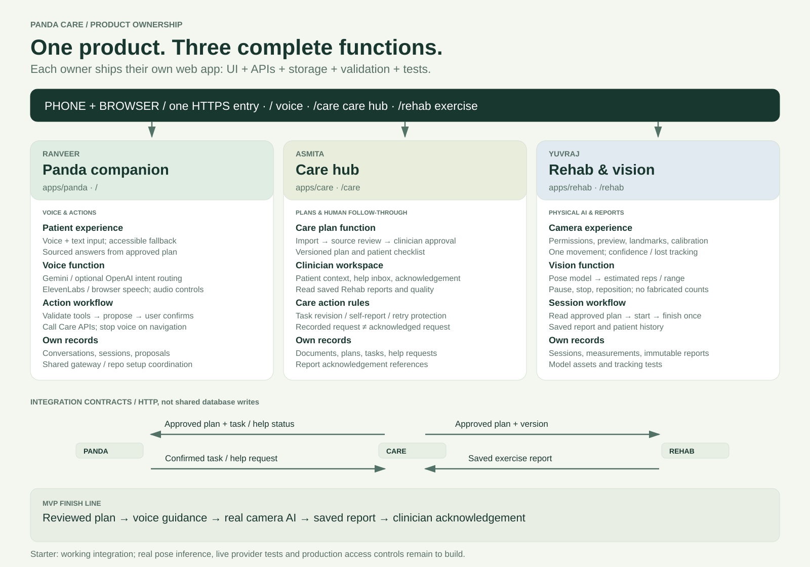
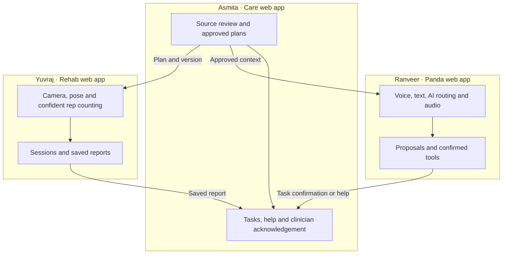

# Product ownership diagram

Each app owns its UI, API, records and tests. Ranveer also wires the shared public gateway; Asmita maintains shared design tokens. The same-origin product paths are `/`, `/care`, `/rehab`. See OWNERSHIP.md for exact source paths, contracts and remaining workflows.
